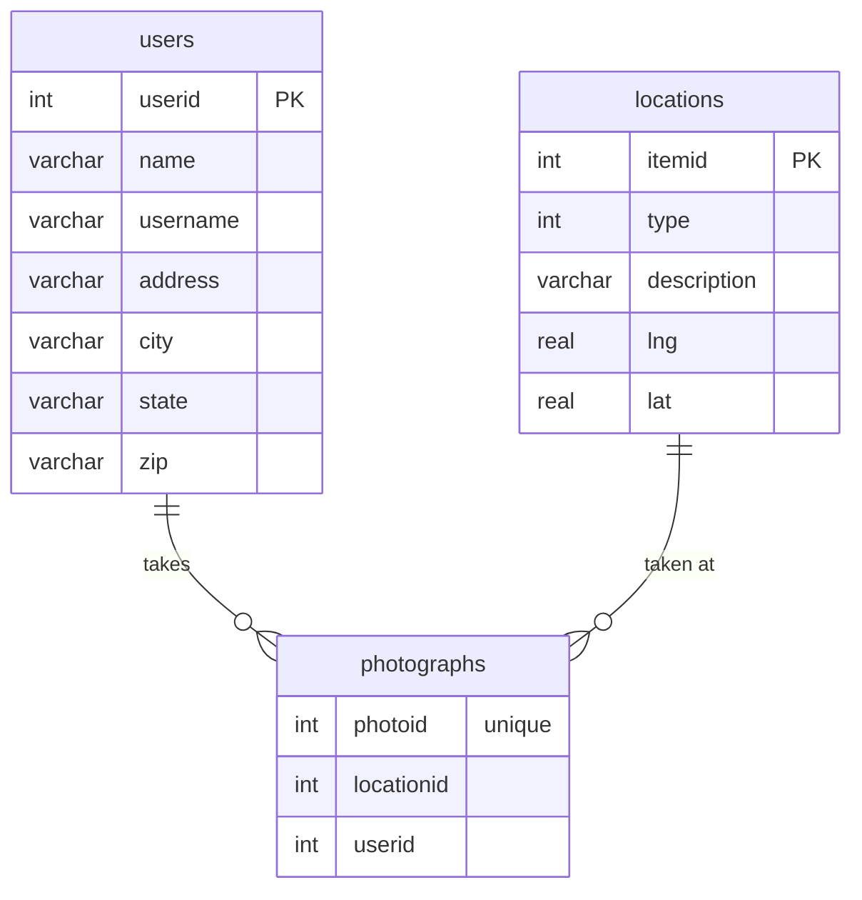
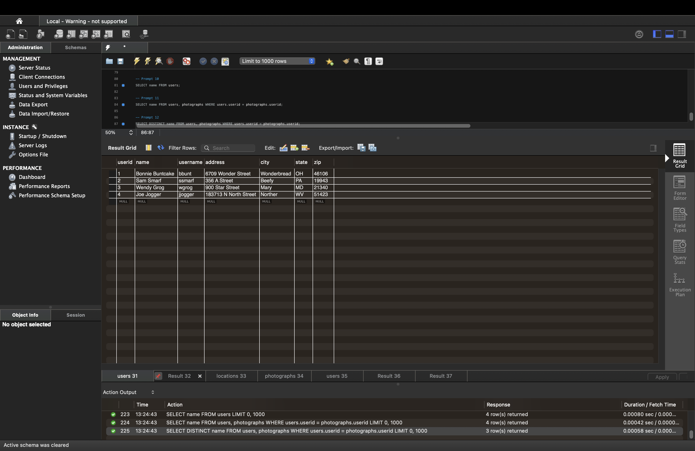
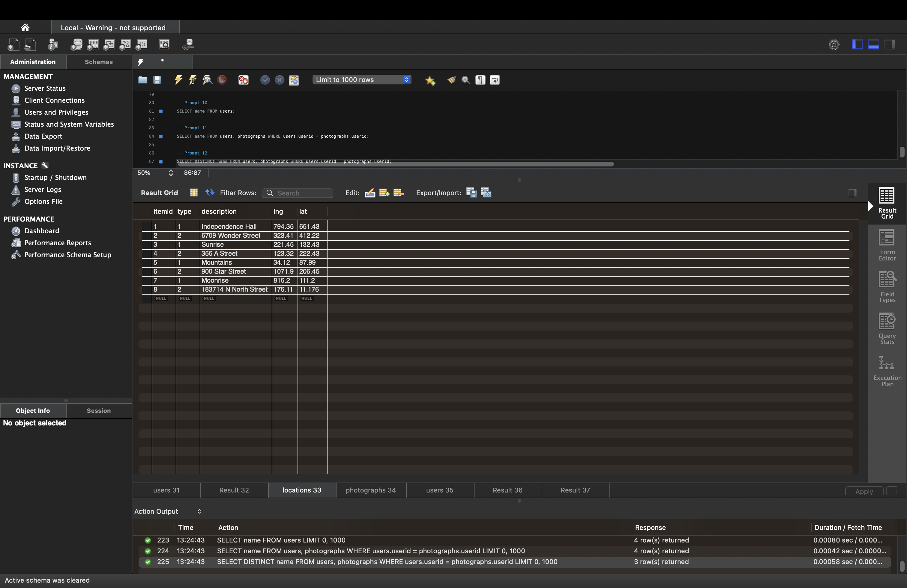
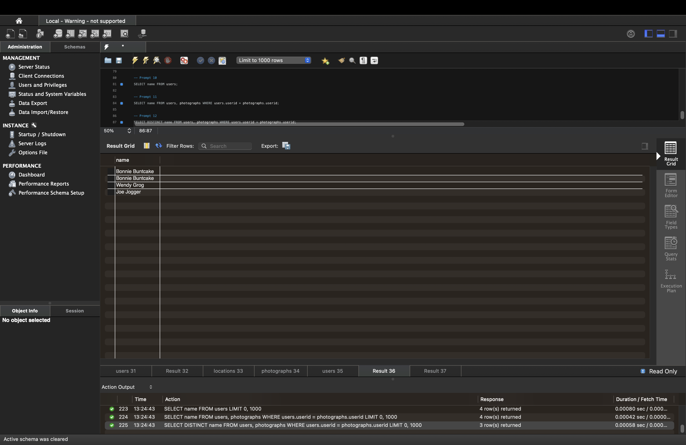
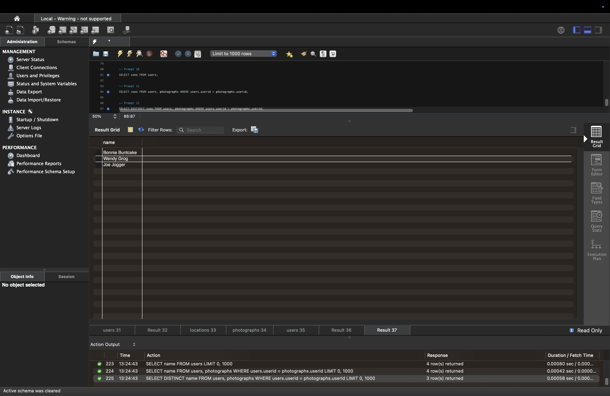

# Photo Sharing Database

A MySQL database for a photo-sharing app: **users**, the **locations** where photos are taken
(stored as latitude and longitude), and the **photographs** that link the two. The script builds
the schema step by step, then answers questions about who has posted photos.

## Schema



`photographs` links to `users` and `locations` by ID. The script doesn't declare these as
foreign-key constraints; adding them would be the natural next step.

## What the script does

1. Creates the `users`, `locations`, and `photographs` tables
2. Tightens the columns with `ALTER TABLE … MODIFY … NOT NULL`
3. Adds unique indexes on user and photo IDs
4. Inserts sample users, locations, and photographs
5. Counts and lists rows
6. Joins users to photographs to find **which users have posted photos**, using `DISTINCT` so each user appears once

## Screenshots (MySQL Workbench)

| Users table | Locations table |
|---|---|
|  |  |

| Users with photographs | Distinct users with photos |
|---|---|
|  |  |

More screenshots are in [`screenshots/`](screenshots).

## Run it

In MySQL 8:

```sql
SOURCE photo_sharing_db.sql;
```

The script creates its own database (`finalproject`), so nothing else needs to be set up first.

## Author

**Ousmana Tunkara** · [GitHub @Kodelack47](https://github.com/Kodelack47)
